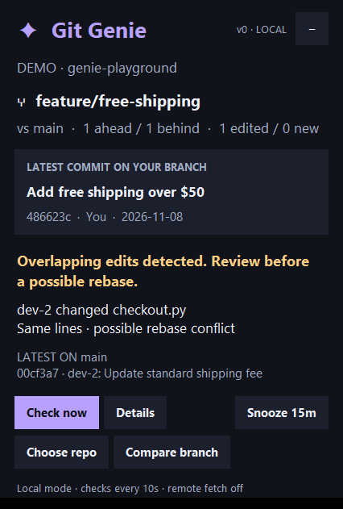

# Original desktop prototype


A small **Windows desktop companion** that floats over VS Code. No editor extension, account, AI model, or Python package dependencies. The first version works entirely with **local branches**.



## Try it

Requires **Python 3.10+ with Tkinter** (included in the standard Windows installer) and **Git for Windows**, both on PATH.

Double-click **`Demo.cmd`** for a working example: `dev-2` changes the shipping fee on `main` while your feature branch changes the same calculation. Genie shows the previous/latest commit on your current branch and warns about a possible rebase conflict. The demo uses a temporary repository and removes it when you quit.

Double-click **`Launch.cmd`**, then **Choose repo** to watch your own repository. Or run from this directory:

```powershell
python -m gitgenie --repo 'C:\path\to\project'
```

Genie compares the checked-out branch to local `main` (or `master`). Use **Compare branch** for another local branch. Switch branches in VS Code as usual; Genie follows on the next check.

## What the popup does

- Checks local changes every **10 seconds**, including staged, unstaged, and untracked paths.
- Shows your current branch, latest commit, author, ahead/behind count, and latest incoming commit.
- Labels overlapping ancestor line ranges as **same lines**, and separate ranges as lower-risk **same file** changes. Names come from actual Git commit authors.
- Flags file deletion, addition, binary changes, and untracked-path collisions. Renames are treated as deletion plus addition.
- Skips duplicate changes when both sides have identical final content.
- Expands the panel when an incoming commit or overlap changes. Repeated checks of the same state do not repeatedly alert.
- Floats above VS Code while the editor is active, without taking keyboard focus during alerts. It also works as a normal desktop window.
- **Details** shows the assessment, relevant commits, and your change summary. **Copy rebase command** copies a PowerShell command for review.
- **−** or **Escape** collapses the panel; **Snooze 15m** pauses alert expansion while checks continue. Drag the Genie heading to move it. Close the window to stop the app.

Genie does not run rebase, merge, pull, stash, checkout, or change your index. Overlap is a deterministic signal, **not a guarantee that a merge will conflict or succeed**. This version compares against the selected base, not all teammates' branches. It can only identify committed changes visible in that local base, not unsaved editor buffers or another developer's uncommitted work. Commit history is capped at 12 incoming commits and 8 attributed commits per overlapping file. Large repositories may take longer than the normal refresh interval.

## Install locally

The per-user installer copies the app to `%LOCALAPPDATA%\Programs\GitGenie`, creates Desktop and Start menu shortcuts, and opens the popup. No administrator rights are required:

```powershell
powershell -NoProfile -ExecutionPolicy Bypass -File .\scripts\Install.ps1 -Repo 'C:\path\to\project'
```

Omit `-Repo` to choose a folder on launch. Pass `-StartOnLogin` to also create a Windows Startup shortcut, or `-NoLaunch` to install without opening the app. The selected repository is stored in the shortcut arguments; choosing another repository in the UI changes only the current session. To uninstall, close Genie, delete the Git Genie shortcuts (including Startup if enabled), and remove its install directory. Python and Git remain installed.

## Remote fetch later (off by default)

Local mode makes no network requests. The optional fetch loop is ready for a later stage:

```powershell
python -m gitgenie --repo 'C:\path\to\project' --remote origin --base origin/main
```

This fetches on launch and every **five minutes**, without interactive authentication prompts, while local checks continue every 10 seconds when Git is idle. Fetch updates only remote tracking refs, with a 75-second timeout. Failed fetches leave the previous local analysis available and retry after five minutes. The base remains the branch you selected; use `--base origin/main` to compare with fetched `main`. Existing Git credentials must already work. [Git fetch documentation](https://git-scm.com/docs/git-fetch).

## Verify

```powershell
python -m unittest discover -s tests -v
python scripts/Smoke-UI.py
python -m gitgenie --demo --check
```

The integration tests use disposable real repositories, including a local bare remote for the optional fetch check. `--check` prints JSON without opening a window or fetching. Native window detection uses the [Windows foreground window API](https://learn.microsoft.com/en-us/windows/win32/api/winuser/nf-winuser-getforegroundwindow).
