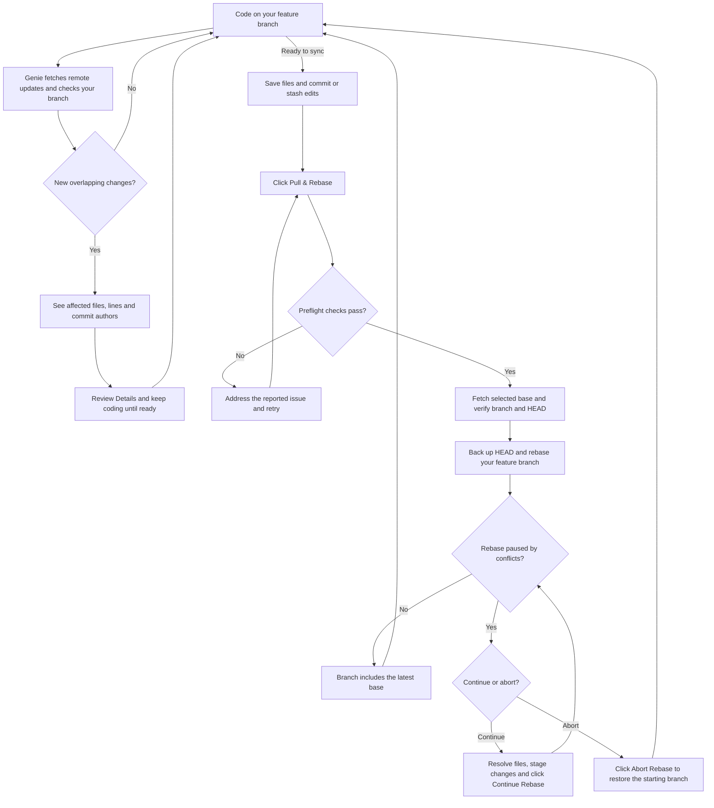
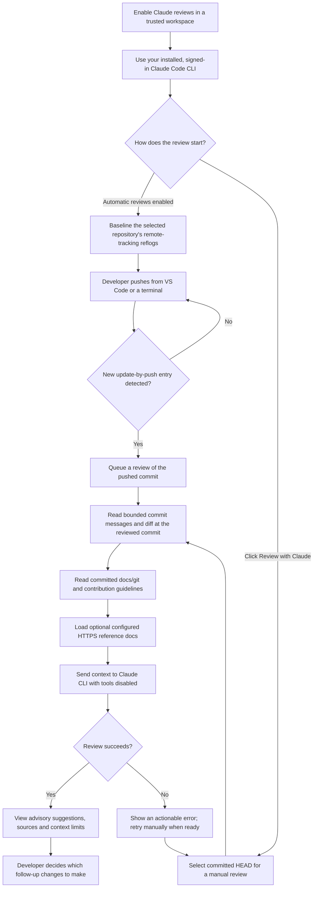

# Git Genie

**Catch overlapping changes early. Pull and rebase with one click.**

Git Genie is an animated Git companion inside VS Code. Rub the golden lamp: it bounces, smoke rises, and your genie appears with your branch status, latest commit, and alerts when a teammate changes the same files or lines.

## Why use it?

You should not need to repeatedly pull main to discover whether someone touched your code. Genie fetches your configured remote on startup and every 30 seconds and checks your branch every 10 seconds and shortly after saves. Fetching updates remote tracking refs without changing your local branches.

Review the overlap and click **Pull & Rebase** when ready. Genie fetches the selected remote base, usually `origin/main`, and rebases your current branch onto it. You do not have to check out or pull local main first.

## Install in VS Code

Requires VS Code 1.85+ and Git 2.38+. Core monitoring needs no Python, AI service, or account. Optional reviews require a recent, signed-in Claude Code CLI. Remote actions use your existing Git credentials.

1. Download the VSIX from the [Git Genie repository](https://github.com/sumanthdonthula/GitGenie).
2. Open the Command Palette and run **Extensions: Install from VSIX…**.
3. Select `git-genie-0.4.0.vsix` and reload the window if prompted.
4. Open a Git project and click the **lamp** in the Activity Bar.

The companion opens on first activation. Summon it later with **Git Genie: Rub the Lamp**, or **Genie** in the status bar. Move **Your Genie** to the **Secondary Side Bar** if you prefer it on the right. The Activity Bar icon is static; the lamp/smoke animation runs inside the side panel.

## What it shows

- Your branch, latest commit and author, incoming commits, and ahead/behind counts.
- Same-line overlaps, lower-risk same-file edits, and file collisions, with real commit authors.
- Staged and unstaged edits and untracked-path collisions.
- Automatic alerts for new overlaps, with a 15-minute snooze option.
- **Details**, **Choose repo**, **Compare branch**, and a clearly labeled sample demo.

## Pull & Rebase

The button displays the target before you click. It requires saved editor files and a clean working tree, including untracked files. Commit or stash unfinished work yourself; Genie does not auto-stash.

Genie fetches the target, verifies your branch has not changed during the fetch, saves the original commit under a local `refs/gitgenie/backups/…` reference, and rebases while preserving merge topology. Local main is left alone. The backup reference and Git output appear in **Output → Git Genie**.

If conflicts occur, resolve and stage the files in Source Control, then click **Continue Rebase**. Use **Abort Rebase** to restore the starting branch instead. Genie never pushes, force-pushes, automatically rebases in the background, or auto-resolves conflicts. Rebasing can change local commit IDs.

## Preferences

- `gitgenie.baseBranch`: comparison base; automatically prefers remote main/master, then local main/master.
- `gitgenie.remote`: remote for background fetching, defaults to `origin`.
- `gitgenie.autoFetch`: startup and 30-second fetches, enabled by default. Disable for offline use.
- `gitgenie.autoReveal`: reveal on new overlaps, enabled by default.
- `gitgenie.animations`: animation, enabled by default; system reduced-motion preferences also apply.

With no remote, local monitoring still works. Restricted Mode allows the lamp and sample demo; Git operations require Workspace Trust.

Overlap signals do not guarantee a conflict or a clean merge. Unsaved buffers are excluded from monitoring. Renames are treated as deletion plus addition. History is capped at 12 incoming commits and 8 attributed commits per overlapping file. Analysis/fetch/rebase timeouts are 20/90/120 seconds; large repositories can take longer than the normal 10-second refresh interval.

See the [project README](https://github.com/sumanthdonthula/GitGenie#readme) for build instructions, tests, and the real Git simulation.

## Optional Claude reviews

Run **Git Genie: Enable Claude Reviews** to review detected pushes with your signed-in Claude Code CLI. Genie reads committed `docs/git/` and contribution guidelines and sends bounded commit/diff context through your Claude account. Suggestions cover Git workflow, commit messages and supported follow-up improvements, with sources. They never modify your repository. **Git Genie: Review with Claude** also reviews committed HEAD manually.

Enablement is a User/Remote machine setting, off by default. Automatic reviews watch the selected repository while VS Code is open; no-op pushes, tag-only pushes and missing remote-tracking reflogs are excluded. Configure `gitgenie.claude.docFolders` and optional HTTPS `gitgenie.claude.referenceUrls`. See the [full setup and limits](https://github.com/sumanthdonthula/GitGenie/blob/main/docs/CLAUDE-REVIEWS.md). Claude account usage/billing applies.

